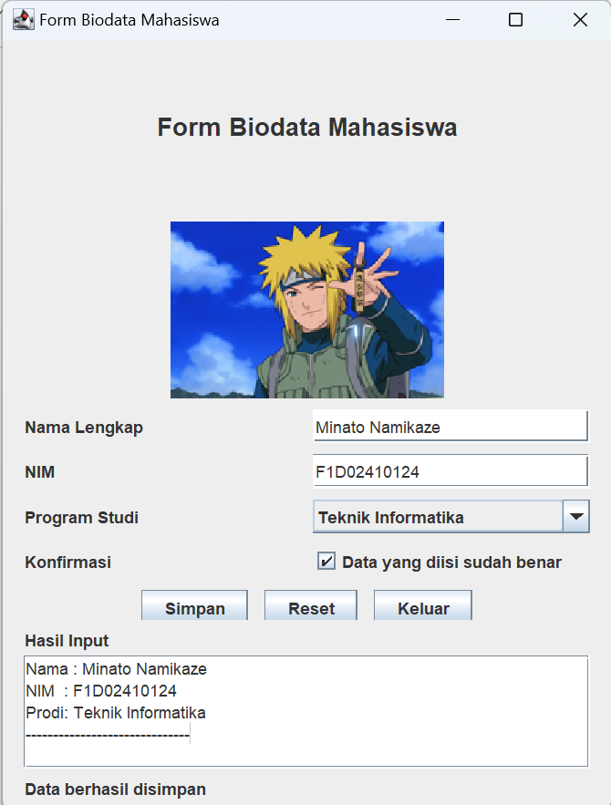

# Latihan GUI Java Swing - Form Biodata Mahasiswa

**NIM  :** (isi NIM)
**Nama :** (isi nama)

Aplikasi form biodata sederhana: isi Nama, NIM, pilih Program Studi, centang konfirmasi, lalu klik **Simpan** untuk menampilkan data di kotak "Hasil Input". **Reset** mengosongkan form, **Keluar** menutup aplikasi.

## Screenshot



## 5 Komponen Utama GUI yang Digunakan

| No | Komponen | Kategori | Fungsi di aplikasi |
|----|----------|----------|--------------------|
| 1 | `JFrame` | Top-level Container Class | Jendela utama aplikasi (`LatihanGUI extends JFrame`). |
| 2 | `JPanel` | Intermediate Container Class | Mengelompokkan komponen: `panelAtas`, `panelTengah`, `panelForm`, `panelTombol`, `panelHasil`. |
| 3 | `JLabel`, `JTextField`, `JComboBox`, `JCheckBox`, `JTextArea`, `JButton` | Atomic Component Class | Judul dan gambar, input nama dan NIM, pilihan prodi, konfirmasi, area hasil, tombol Simpan/Reset/Keluar. |
| 4 | `BorderLayout`, `GridLayout`, `FlowLayout` | Layout Classes | `BorderLayout` untuk frame dan pembagian panel, `GridLayout` untuk baris form dan judul-gambar, `FlowLayout` untuk deretan tombol. |
| 5 | `ActionListener` | Event Listener Interface | `LatihanGUI implements ActionListener`, method `actionPerformed(ActionEvent e)` di-override untuk menangani klik tombol. |

## Cara Menjalankan

```
javac LatihanGUI.java
java LatihanGUI
```

Jalankan dari folder ini supaya folder `assets/` terbaca.
